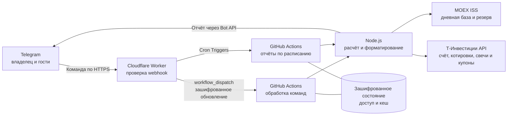

# Portfolio Pulse

Telegram-бот для мониторинга инвестиционного портфеля на Московской бирже. Собирает позиции, котировки и купоны, формирует отчёты и доставляет их по расписанию или по команде. Запускается в облаке при выключенном домашнем компьютере.

**Стек** · Node.js · Cloudflare Workers · GitHub Actions · Telegram Bot API · MOEX ISS · Т‑Инвестиции API

В этом репозитории лежит демонстрационный срез с вымышленным портфелем и воспроизводимыми тестами. Ниже описана актуальная рабочая архитектура. Команды запуска демо относятся к коду в этом репозитории.

## Что показывает проект

- **Отчёт по портфелю.** Общая стоимость, рублёвый остаток, количество бумаг, изменение цены и результат к себестоимости. Для облигаций — ближайшие купоны, суммы по месяцам и отдельная оценка годового купонного потока.
- **Краткие сигналы.** Бот сопоставляет завершённые дневные свечи, SMA 20/50, MACD, стохастик, поддержку и сопротивление со средней ценой позиции, дивидендными событиями и доступными раскрытиями эмитентов. В Telegram выводится компактная таблица с действием.
- **Раздельный доступ.** Владелец получает сводку каждые четыре часа в торговом окне, а в первом утреннем запуске также получает сигналы. Авторизованные гости могут открыть сводку из меню и получают её автоматически в последнем запуске дня.

## Архитектура



**Почему webhook.** Опрос Telegram по расписанию зависел от того, запустится ли GitHub Actions вовремя. Webhook запускает обработку по факту команды. Cloudflare также вызывает отдельный сценарий GitHub Actions для плановых отчётов.

**Как экономятся запросы.** Бот запрашивает биржевые цены пачками и догружает только новые дневные свечи. Купоны и дивиденды кешируются на 12 часов. Последний запуск дня переиспользует рыночные данные для гостевой сводки.

**Как защищены данные.** В рабочей установке используются токен брокера только для чтения, проверка ролей в личном чате, шифрование содержимого webhook и кеша GitHub Actions и ограничение частоты запуска команд. В сводки Actions выводятся только демонстрационные отчёты.

## Демо за минуту

Требуется **Node.js 22+**. Установка пакетов и токены не нужны.

```bash
node demo/preview.mjs
node --test
```

Команда печатает Markdown-отчёт с вымышленными позициями и котировками. [Посмотреть результат](docs/demo-report.md) · [Устройство и компромиссы](docs/architecture.md) · [Как развернуть свою копию](docs/deployment.md)

Для проверки на текущих публичных данных ISS можно выполнить `node portfolio.mjs`. Он использует демонстрационные позиции и выводит отчёт в терминал, если переменные боевой конфигурации не заданы.

## Структура кода

| Модуль | Ответственность |
|---|---|
| `portfolio.mjs`, `requests.mjs` | Оркестрация, запросы ISS, кеш и выбор режима запуска |
| `report.mjs`, `stock-analysis.mjs` | Расчёты портфеля, правила сигналов, HTML и Markdown |
| `broker-quotes.mjs` | Чтение состава, котировок и дивидендного календаря через брокера |
| `webhook-worker.mjs`, `telegram-bridge.mjs` | Приём команд и шифрование обновлений Telegram |
| `bot-access.mjs`, `bot-store.mjs`, `telegram.mjs` | Авторизация гостей, хранение доступа и доставка отчётов |

**Границы проекта.** Бот наблюдает за портфелем и объясняет сигналы. Торговых операций в коде нет. Расписание GitHub Actions допускает задержки и пропуски. Статический пример использует вымышленные данные.
