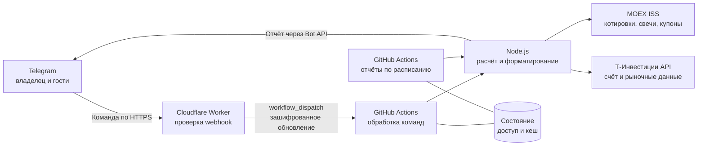

# Portfolio Pulse

Telegram-бот для мониторинга инвестиционного портфеля на Московской бирже. Собирает позиции, котировки и купоны, формирует отчёты и доставляет их по расписанию или по команде. Запускается в облаке при выключенном домашнем компьютере.

**Стек:** Node.js · Cloudflare Workers · GitHub Actions · Telegram Bot API · MOEX ISS · Т‑Инвестиции API

## Что показывает проект

- **Отчёт по портфелю.** Общая стоимость, рублёвый остаток, количество бумаг, изменение цены и результат к себестоимости. Для облигаций — ближайшие купоны, суммы по месяцам и отдельная оценка годового купонного потока.
- **Анализ по команде.** Короткие сценарии «Держать», «Докупить» и «Сократить» с причиной и раскрывающимися деталями. Используются завершённые дневные свечи, SMA 20/50, MACD, стохастик, средняя цена позиции и доступные сведения о дивидендных отсечках.
- **Раздельный доступ.** Владелец управляет доступом, получает технический анализ и сводки каждые три часа в торговом окне. Авторизованные гости могут открыть сводку из меню и получают одну автоматическую сводку в день в последнем запуске владельца.

## Архитектура



**Почему webhook.** Опрос Telegram по расписанию зависел от того, запустится ли GitHub Actions вовремя. Webhook запускает обработку по факту команды. Плановые отчёты остаются отдельным сценарием GitHub Actions.

**Как экономятся запросы.** Котировки загружаются пачками по торговому режиму. Купонные данные кешируются на 6 часов, дивидендный календарь — на 12. В финальном запуске дня гостевая сводка строится из уже загруженных данных ISS.

## Демо за минуту

Требуется **Node.js 22+**. Установка пакетов и токены не нужны.

```bash
node demo/preview.mjs
node --test
```

Команда печатает Markdown-отчёт с вымышленными позициями и котировками. [Посмотреть результат](docs/demo-report.md) · [Устройство и компромиссы](docs/architecture.md) · [Как развернуть свою копию](docs/deployment.md)

Для проверки на текущих публичных данных ISS можно выполнить `node portfolio.mjs`. Он использует демонстрационные позиции и выводит отчёт в терминал, если переменные боевой конфигурации не заданы.

## Структура кода

| Модуль | Ответственность |
|---|---|
| `portfolio.mjs`, `requests.mjs` | Оркестрация, запросы ISS, кеш и выбор режима запуска |
| `report.mjs`, `stock-analysis.mjs` | Расчёты портфеля, правила сигналов, HTML и Markdown |
| `broker-quotes.mjs` | Чтение состава, котировок и дивидендного календаря через брокера |
| `webhook-worker.mjs`, `telegram-bridge.mjs` | Приём команд и шифрование обновлений Telegram |
| `bot-access.mjs`, `bot-store.mjs`, `telegram.mjs` | Авторизация гостей, хранение доступа и доставка отчётов |

**Границы проекта.** Бот наблюдает за портфелем и объясняет сигналы. Торговых операций в коде нет. Расписание GitHub Actions допускает задержки и пропуски. Статический пример использует вымышленные данные.
